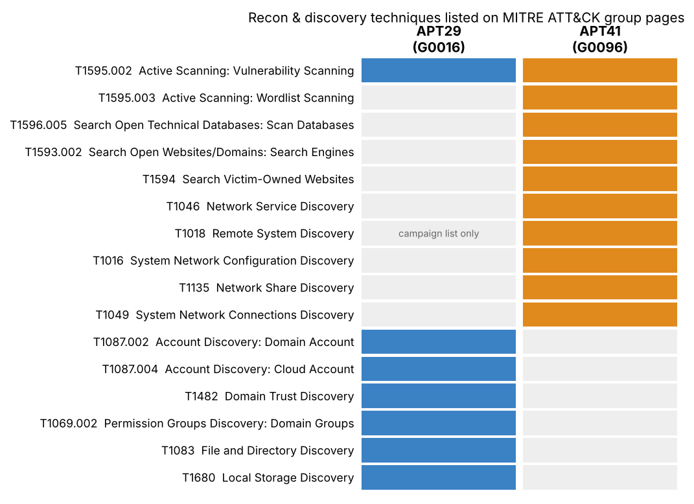

# Week 10 – APT29 and APT41 techniques applied to *Port Scanning and Reconnaissance*

**Course:** Introduction to Threat Hunting (ITH), 2026-2027, syllabus section 3.3, Week 10
**Syllabus task:** *Analyze the TTPs of APT29 or APT41. Map the observed techniques to the MITRE ATT&CK framework.*
**Our topic:** Port Scanning and Reconnaissance  |  Aitzhan Tursynbek CS-2427

## 1. Scope
We analyse **both** groups, restricted to the part of the kill chain that matches our topic: reconnaissance (TA0043) and
network/environment discovery (TA0007). Source: the MITRE ATT&CK group pages **APT29 (G0016)** and **APT41 (G0096)**, ATT&CK v20 (group entries
v6.2 and v4.2, both last modified 31 July 2026, as shown on the pages when we read them).

| | APT29 | APT41 |
|---|---|---|
| Aliases (ATT&CK) | IRON RITUAL, IRON HEMLOCK, NobleBaron, Dark Halo, NOBELIUM, UNC2452, YTTRIUM, The Dukes, Cozy Bear, CozyDuke, SolarStorm, Blue Kitsune, UNC3524, Midnight Blizzard | Wicked Panda, Brass Typhoon, BARIUM (partial overlap with Winnti Group) |
| Typical recon style | targeted, quiet, identity and cloud oriented | broad tooling, commodity scanners, custom malware |

## 2. Observed techniques mapped to ATT&CK
Full table with procedure text: `ttp_mapping.csv`. ATT&CK Navigator layer: `navigator/apt29_apt41_recon_layer.json`.

### Reconnaissance (TA0043)
| ID | Technique | APT29 | APT41 |
|---|---|---|---|
| T1595.002 | Active Scanning: Vulnerability Scanning | "widespread scanning of target environments to identify vulnerabilities for exploit" (NCSC advisory) | Acunetix SQL-injection scanner and JexBoss for Java apps |
| T1595.003 | Active Scanning: Wordlist Scanning | – | brute-forces web-server directories |
| T1596.005 | Search Open Technical Databases: Scan Databases | – | fofa.su, a Shodan-like service, for passive scanning |
| T1593.002 / T1594 | Search engines / victim-owned websites | – | DUST campaign |

### Discovery (TA0007)
| ID | Technique | APT29 | APT41 |
|---|---|---|---|
| **T1046** | **Network Service Discovery** | – | **WIDETONE malware: port scans on specified subnets** |
| T1018 | Remote System Discovery | only in campaign technique list | MiPing to find active systems |
| T1016 / T1049 / T1135 | Network config / connections / shares | – | MAC collection, `ping %userdomain%`, `netstat`, `net share`, HIGHNOON for RDP sessions |
| T1087.002 / T1087.004 | Domain / cloud accounts | `Get-ADUser`, `Get-ADGroupMember`; Azure AD enumeration | – |
| T1482, T1069.002 | Domain trusts / domain groups | `Get-AcceptedDomain`, AdFind | – |
| T1083, T1680 | File & directory / local storage | `Get-WebServicesVirtualDirectory`, `fsutil` | – |

*A "–" means the technique was not in the extract we read, not proof that the group never used it.* For APT29 the page was cut at 100 000 of 101 957
characters, and for APT41 we only extracted network-related techniques.

## 3. Findings
1. **Port scanning is explicit in APT41, implicit in APT29.** APT41 uses all three scanning layers: passive (fofa.su), active with commodity tools
   (Acunetix, JexBoss, directory brute force) and internal port scanning with custom malware (WIDETONE, T1046). APT29's page shows
   internet-wide vulnerability scanning (T1595.002) but then moves quickly to **identity discovery** (AD, Azure AD, trusts): after the first foothold
   it asks "who and what is trusted", not "which ports are open".
2. **Hunting consequence.** For APT41-style activity, network telemetry is the main source (many ports from one host, scanning from an
   internal workstation = T1046). For APT29-style activity, port-scan rules will not help; hunt the LDAP/PowerShell/Graph API enumeration instead.
3. **Commodity tools make attribution by tool useless.** Acunetix, nmap-like scans and `net share` are used by every pentester; hunt by behaviour and context (who scans, from where, when).

## 4. Link to Week 9
| Week 9 lab | ATT&CK | Group relevance |
|---|---|---|
| Atomic T1046 #1 and python scanner (runs B, C) | T1046 | Matches APT41 WIDETONE subnet port scans (same behaviour, simpler tool) |
| Same scan run against an external IP block | T1595.001 | Same behaviour class as APT29/APT41 T1595.002 scanning; the group pages list .002 (vulnerability scanning), not .001 |
| Slow scan, run D | T1046 (evasion by pacing) | Quiet actors like APT29 favour low noise; shows why PS-2 (120 s window) is needed |

## 5. Hunting hypotheses and data needed
| # | Hypothesis | Data | Query / rule |
|---|---|---|---|
| H1 | A workstation or server scans internal subnets (APT41 T1046) | firewall / Zeek conn | PS-1, PS-2, PS-3 (`detect/siem/`) |
| H2 | External sources probe our public IP range for vulnerabilities (T1595.002) | perimeter firewall, WAF | same rules on inbound traffic, plus WAF alerts for Acunetix-like user agents |
| H3 | Mass directory brute-force on a web server (T1595.003) | web server logs | many 404 for distinct paths per IP |
| H4 | Bulk AD enumeration (APT29 T1087.002, T1069.002) | Windows 4662/4661, LDAP logs, PowerShell 4104 | `Get-ADUser`/`Get-ADGroupMember`/AdFind in script blocks |
| H5 | Burst of `netstat`, `net share`, `ping %userdomain%` from one host (APT41 T1049, T1135, T1016) | Sysmon EID 1 | ≥ 3 of these commands in 5 min from one parent process |

## 6. Limitations
* Based on public ATT&CK group pages, not on raw intelligence reports (Mandiant, CrowdStrike, Microsoft); procedure examples are as MITRE summarises them.
* H2–H5 were not tested in our lab; only H1 was (Week 9).
* Navigator layer declares ATT&CK `v20` as read on the group pages; if your Navigator build does not know v20, open it with the nearest supported version.

## 7. Sources
* MITRE ATT&CK, APT29 – <https://attack.mitre.org/groups/G0016/> (cites NCSC SVR advisory, CrowdStrike StellarParticle, Volexity, Microsoft).
* MITRE ATT&CK, APT41 – <https://attack.mitre.org/groups/G0096/>.
* Syllabus ITH 2026-2027, section 3.3, week 10 (recommended reading: Mandiant APT1 report, CrowdStrike Global Threat Report – not used here).
