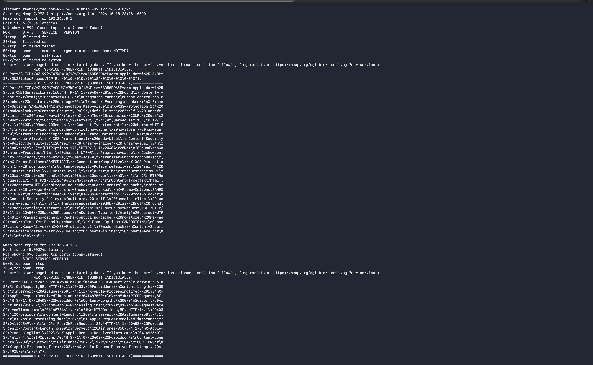
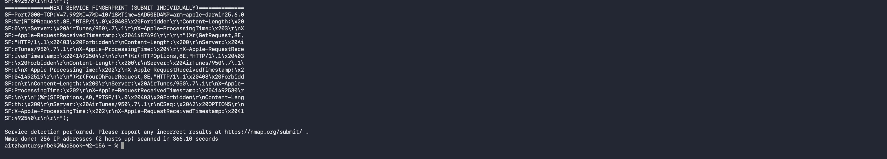
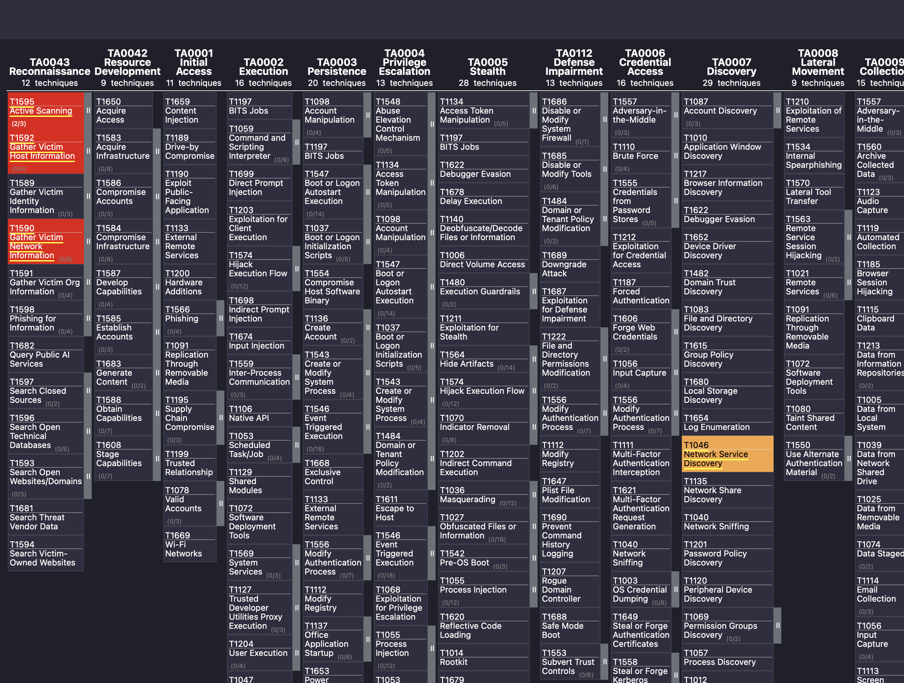

# Week 6 — ATT&CK Framework
### Applied to: Port Scanning and Reconnaissance

**Group:** CS-2427
**Date:** 12.10
**Team members:** Tursynbek

---

## 1. Why this week matters for our project

Weeks 1–2 studied reconnaissance from the **outside looking in**: an
attacker (or us, legally, against `scanme.nmap.org`) scanning a target
*before* gaining any access, mapped to **T1595 — Active Scanning**
(the Reconnaissance tactic, TA0043).

This week studies a **different, related** technique that happens
**after** an attacker already has a foothold: once inside a network,
attackers scan the *internal* network to find other reachable hosts and
services to move toward their real target. This is exactly what
happened in the Equifax case we analyzed in Week 4 (Stage 7b — "lateral
movement and internal reconnaissance", where attackers queried 48
internal databases after their initial foothold).

**Chosen technique: T1046 — Network Service Discovery**

| Field | Value |
|---|---|
| Technique ID | T1046 |
| Name | Network Service Discovery |
| Tactic | Discovery (TA0007) |
| ATT&CK URL | https://attack.mitre.org/techniques/T1046/ |

**MITRE's definition (paraphrased):** adversaries, once on a system, try
to get a listing of services running on *other* hosts on the network —
including ones that may be vulnerable to further exploitation — often
using the same kind of port-scanning tools (like Nmap) that external
attackers use, just pointed *inward* instead of at the internet.

**Key distinction we want to highlight (this is the main learning point
of this week):**

| | T1595 (Week 1–2) | T1046 (this week) |
|---|---|---|
| Tactic | Reconnaissance (TA0043) | Discovery (TA0007) |
| When | **Before** any access to the target | **After** an attacker already has a foothold |
| Direction | External attacker → internet-facing target | Compromised internal host → rest of the internal network |
| Kill Chain stage | Stage 1 | Inside Stage 7 (Actions on Objectives) — this is literally what we labeled "7b" in our Week 4 Equifax analysis |

Same underlying activity (port scanning), same tool category (Nmap and
similar), but a **different ATT&CK tactic** depending on *where in the
attack* it happens — a good concrete illustration of why ATT&CK
separates "tactic" (the why/when) from "technique" (the how).

---

## 2. Simulating the technique ourselves

Per the task ("simulate an attack and map results to ATT&CK"), we
simulated **internal network service discovery** — the same action an
attacker would take after compromising one machine on a LAN, now
looking for other live hosts/services to move toward next.

**Important ethical note:** we only scanned devices and IP ranges **we
personally own and have explicit permission to test** — our own home
network / personal lab devices — never a network belonging to someone
else.

### What we ran

```bash
# Discover live hosts + open services on our own local network
nmap -sV 192.168.1.0/24
```

*(Replace `192.168.1.0/24` with your own actual local subnet — check it
first with `ipconfig getifaddr en0` on Mac, or `ip addr` on Linux. Only
ever point this at a network you own.)*





### What we expected / found

Unlike our Week 2 scan of a single, known, internet-facing host
(`scanme.nmap.org`), an internal LAN scan typically reveals **several**
different devices at once: routers/gateways (often port 80/443 for
admin panels), other computers on the network (ports like 22, 445,
5000, 7000 depending on OS and installed apps), smart-home devices,
printers, etc. This is exactly what makes T1046 valuable to an attacker
who has landed on one machine — it reveals the "shape" of the whole
internal network in one step.

### Fill in your actual results here

| IP found | Open ports | Likely device/service |
|---|---|---|
| `192.168.0.1` | 53/tcp (domain), 80/tcp (ssl/http) | Network router/gateway — DNS service and web-based administration interface (HTTPS) |
| `192.168.0.138` | 5000/tcp (rtsp — AirTunes), 7000/tcp (rtsp — AirTunes) | Your own Mac (AirPlay/AirTunes — Apple's audio synchronization service) |

---

## 3. ATT&CK mapping of what we simulated

| What we did | ATT&CK Technique | Tactic |
|---|---|---|
| Scanned our own subnet for live hosts and open ports | **T1046** — Network Service Discovery | Discovery (TA0007) |
| (If any host showed a recognizable old/vulnerable service version) | T1046 feeds into **T1595.002**-style vulnerability assessment of the *next* target | — |

This mirrors the real-world pattern: **T1595 gets an attacker in the
door** (external recon → initial access), **T1046 helps them find where
to go next once they're inside**.

---

## 4. ATT&CK Navigator layer

We built an ATT&CK Navigator layer (`week6_attck_navigator_layer.json`)
highlighting both techniques studied across our project so far, to
visualize how our weekly work has moved across the matrix:

- **T1595** (Reconnaissance tactic) — Weeks 1–2, external scan of scanme.nmap.org
- **T1046** (Discovery tactic) — this week, internal scan of our own lab network

**How to view it:**
1. Go to https://mitre-attack.github.io/attack-navigator/
2. Click **Open Existing Layer → Upload from local**
3. Select `week6_attck_navigator_layer.json`

 (after uploading,
screenshot the matrix showing the two highlighted techniques)

---

## 5. Connecting this to our MISP event (Week 3)

To keep our project's data pipeline consistent (same pattern as Week 4's
update to MISP Event 2), we can add a new attribute/tag reflecting this
week's technique:
- ATT&CK galaxy tag for **T1046**
- Comment: "Internal network discovery technique studied Week 6 —
  complements external T1595 reconnaissance from Weeks 1–2"

---

## 6. Sources

- MITRE ATT&CK, T1046 — Network Service Discovery: https://attack.mitre.org/techniques/T1046/
- MITRE ATT&CK Navigator documentation: https://github.com/mitre-attack/attack-navigator
- MITRE ATT&CK, T1595 — Active Scanning (for comparison): https://attack.mitre.org/techniques/T1595/

## AI usage disclosure

Cloud AI (Claude Sonnet 5, Anthropic) was used to help write and
structure this report and prepare the ATT&CK Navigator layer file. The
actual network scan was run by our team against our own, permitted
local network.
