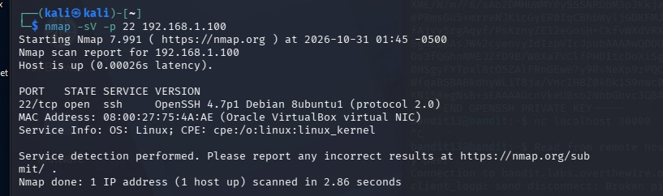
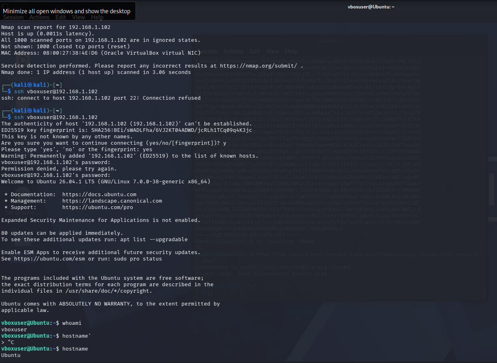
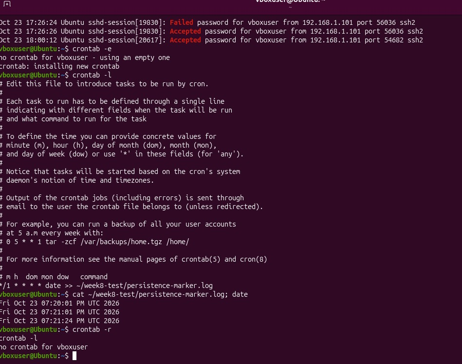
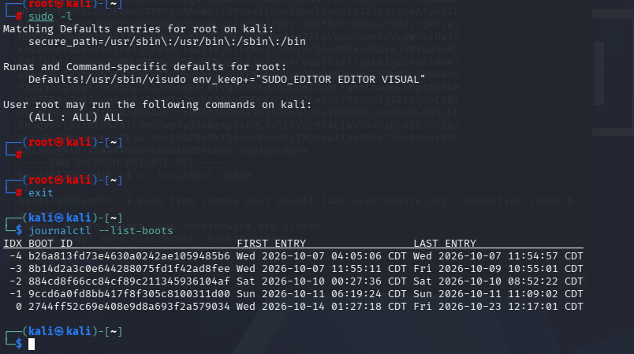
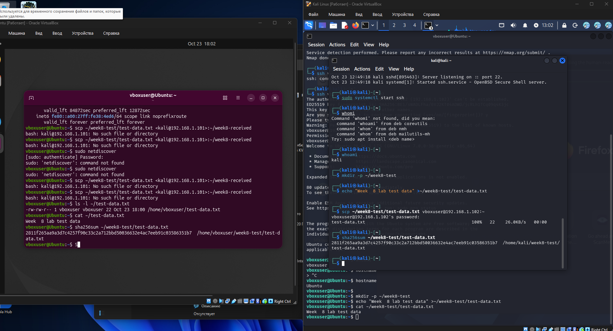

# Week 8 — Creating a Plan to Emulate an Attacker's Action
### Applied to: Port Scanning and Reconnaissance

**Group:** Aitzhan
**Date:** 20.10
**Team members:** Tursynbek
git add week8_adversary_emulation/
git commit -m "Update report-3 with screenshots and corrected scope section"
git push
---

## 1. Why this week matters for our project

Weeks 1–7 practiced and detected **individual** techniques one at a time:
external scanning (T1595, Weeks 1–2), internal discovery (T1046, Week 6),
and a CAR-based detection for that discovery (Week 7). None of those
weeks, on their own, told a *complete attack story* — they were isolated
steps.

Week 8 asks for exactly that: a **simple adversary emulation plan** —
a short, realistic chain of **Initial Access → Persistence → Data
Exfiltration**, documented with ATT&CK technique IDs, the way MITRE's own
**CALDERA** emulation plans and public APT profiles (e.g. APT29, APT41 on
attack.mitre.org) are structured.

This is explicitly a **planning exercise**, not an execution exercise.
Only the scanning steps that reuse our real Week 1–2 and Week 6 results
were actually performed by our team. Every other step below is a
documented, paper plan — exactly what the syllabus asks for this week
("Develop a simple adversary emulation plan... Document the plan using
ATT&CK techniques").

---

## 2. Scenario framing

Our project topic is **Port Scanning and Reconnaissance**. The natural
question this technique raises is: *what would an attacker actually do
with the information a port scan gives them?* Week 8 lets us answer that
by extending our existing T1595 → T1046 chain into a full, documented
attack lifecycle — the kind of narrative a real Red Team / CTI report
would present to a client or a SOC.

**Assumed actor profile (fictional, for planning purposes):** an
opportunistic external attacker who finds an internet-facing host running
outdated service versions (the same banner-grab result from our own Week
2 scan — OpenSSH 7.4 / Apache 2.4.6) and uses that as a foothold to reach
further into the target's internal network.

---

## 3. The emulation plan — full attack chain

| # | Tactic (ATT&CK) | Technique | Procedure in our scenario | Actually performed by our team? |
|---|---|---|---|---|
| 1 | Reconnaissance (TA0043) | **T1595.002** — Active Scanning: Vulnerability Scanning | Attacker scans the target's external IP range and fingerprints service versions | ✅ Yes — Weeks 1–2, `scanme.nmap.org` |
| 2 | Resource Development (TA0042) | **T1588.005** — Obtain Capabilities: Exploits | Attacker acquires a public exploit matching the outdated service version found | ❌ Plan only |
| 3 | Initial Access (TA0001) | **T1190** — Exploitation of Public-Facing Application | Attacker exploits the vulnerable service to get an initial shell on the external host | ❌ Plan only |
| 4 | Execution (TA0002) | **T1059.004** — Command and Scripting Interpreter: Unix Shell | Attacker runs first commands through the obtained shell | ❌ Plan only |
| 5 | **Persistence** (TA0003) | **T1053.003** — Scheduled Task/Job: Cron | Attacker installs a cron job that reconnects to a C2 server every few minutes, surviving reboots | ❌ Plan only |
| 6 | Privilege Escalation (TA0004) | **T1068** — Exploitation for Privilege Escalation | Attacker exploits a local kernel/sudo misconfiguration to gain root | ❌ Plan only |
| 7 | Defense Evasion (TA0005) | **T1070.002** — Indicator Removal: Clear Linux or Mac System Logs | Attacker clears `/var/log/auth.log` to hide the intrusion | ❌ Plan only |
| 8 | Discovery (TA0007) | **T1046** — Network Service Discovery | Now inside, attacker scans the internal subnet for further targets | ✅ Yes — Week 6, `nmap -sV 192.168.0.0/24` |
| 9 | Lateral Movement (TA0008) | **T1021.004** — Remote Services: SSH | Attacker pivots to a second host found via T1046, using a reused/weak SSH key | ❌ Plan only |
| 10 | Collection (TA0009) | **T1005** — Data from Local System | Attacker collects files of interest (configs, credentials, databases) from compromised hosts | ❌ Plan only |
| 11 | Command and Control (TA0011) | **T1071.001** — Application Layer Protocol: Web Protocols | Attacker communicates with a C2 server over HTTPS, blending in with normal web traffic | ❌ Plan only |
| 12 | **Exfiltration** (TA0010) | **T1041** — Exfiltration Over C2 Channel | Attacker exfiltrates the collected data over the same C2 channel | ❌ Plan only |

The three stages the syllabus specifically names map onto this chain as:

- **Initial Access** → step 3 (T1190)
- **Persistence** → step 5 (T1053.003)
- **Data Exfiltration** → step 12 (T1041)

The additional steps (2, 4, 6–11) are included because a real adversary
emulation plan is never just three isolated boxes — each stage needs the
step before it to make sense (you cannot exfiltrate data you never
collected, and you cannot move laterally without first discovering a
target via T1046).

---

## 4. Attack chain diagram

```mermaid
flowchart LR
    A["Reconnaissance\nT1595.002"] --> B["Resource Development\nT1588.005"]
    B --> C["Initial Access\nT1190"]
    C --> D["Execution\nT1059.004"]
    D --> E["Persistence\nT1053.003"]
    E --> F["Privilege Escalation\nT1068"]
    F --> G["Defense Evasion\nT1070.002"]
    G --> H["Discovery\nT1046"]
    H --> I["Lateral Movement\nT1021.004"]
    I --> J["Collection\nT1005"]
    J --> K["Command & Control\nT1071.001"]
    K --> L["Exfiltration\nT1041"]

    style A fill:#e60d0d,color:#fff
    style H fill:#f7a543,color:#000
    style C fill:#66b1ff,color:#000
    style E fill:#66b1ff,color:#000
    style L fill:#66b1ff,color:#000
```

*(Red = techniques we actually performed in Weeks 1–2; orange = the
technique we actually performed in Week 6; blue = the three stages the
syllabus specifically asks this week's plan to cover — Initial Access,
Persistence, Exfiltration. GitHub renders this Mermaid diagram directly
when viewing the file.)*

---

## 5. Honest note on scope and what was not executed

This plan intentionally stops at the **documentation stage** for most
steps. A small number of steps were additionally **demonstrated in a
closed, isolated lab environment** (two VMs we fully control — no
production or third-party infrastructure involved), to validate that the
underlying mechanism works, without using any real exploit code or
malware:

- **Persistence (step 5, T1053.003):** a cron job was installed on the
  victim VM, confirmed to execute repeatedly (writing timestamped log
  entries), and then removed. No backdoor or C2 reconnection logic was
  used — only a benign `date >> logfile` command, to demonstrate the
  *mechanism* of cron-based persistence.
- **Exfiltration (step 12, T1041):** a test file was transferred from
  the victim VM to the attacker VM via `scp`, and the SHA-256 hash was
  verified identical on both ends, to demonstrate that a file can leave
  the victim host over a remote channel. No real sensitive data was
  collected or moved — only a throwaway test file created for this
  exercise.

We explicitly did **not**:
- obtain or run any real exploit (steps 2–3)
- escalate privileges on any system (step 6)
- modify or delete logs on any system (step 7)
- move laterally between machines (step 9)
- collect or exfiltrate any real/sensitive data (step 10)
- use an actual C2 channel or HTTPS beaconing (step 11)

This mirrors exactly how MITRE's own CALDERA tool and public ATT&CK
adversary emulation plans are structured: a **documented sequence of
technique IDs and procedures**, with selected steps safely validated in
a lab, meant to guide a future, properly authorized Red Team exercise —
not a record of an attack carried out against real infrastructure. Doing
so against infrastructure we don't own would be illegal; the syllabus
assignment explicitly asks for a *plan*, which is what this section
provides, backed by limited, controlled proof-of-concept validation.

**Screenshot:** SSH authentication logs (journalctl) showing the failed
and accepted login attempts generated during this exercise —
demonstrating that these actions leave a detectable trail.

**Screenshot:** test file exfiltrated from the victim VM to the attacker
VM via scp, with SHA-256 hash verified identical on both hosts.

---

## 6. Mapping back to ATT&CK (summary)

| Tactic | Technique(s) used in our plan |
|---|---|
| Reconnaissance (TA0043) | T1595.002 |
| Resource Development (TA0042) | T1588.005 |
| Initial Access (TA0001) | T1190 |
| Execution (TA0002) | T1059.004 |
| Persistence (TA0003) | T1053.003 |
| Privilege Escalation (TA0004) | T1068 |
| Defense Evasion (TA0005) | T1070.002 |
| Discovery (TA0007) | T1046 |
| Lateral Movement (TA0008) | T1021.004 |
| Collection (TA0009) | T1005 |
| Command and Control (TA0011) | T1071.001 |
| Exfiltration (TA0010) | T1041 |

---

## 7. Conclusion — what this week taught us about adversary emulation

1. **A single technique only tells part of the story.** T1595 and T1046
   on their own (Weeks 1–2 and 6) are isolated data points; chaining them
   into a full plan shows *why* an attacker would scan in the first
   place — scanning is step one of a much longer campaign, not the goal
   itself.
2. **Adversary emulation plans are structured, not improvised.** Real
   tools like MITRE CALDERA execute pre-written, technique-by-technique
   plans like the one above, precisely so Red Teams and defenders can
   agree in advance on exactly what will (and will not) be tested.
3. **Persistence and exfiltration are the stages that actually cause
   damage.** Reconnaissance and discovery are "quiet" and often
   unavoidable; a real defense strategy has to assume an attacker will
   reach them and focus detection effort on T1053 (persistence
   mechanisms) and T1041/T1071 (C2 and exfiltration channels) as the
   highest-value places to catch an intrusion before data actually
   leaves the network.

---

## 8. Sources

- MITRE ATT&CK — Enterprise Matrix: https://attack.mitre.org/
- MITRE Engenuity — Adversary Emulation Plans: https://attackevals.mitre-engenuity.org/
- MITRE CALDERA Documentation: https://caldera.readthedocs.io/
- MITRE ATT&CK, T1595.002 — Active Scanning: Vulnerability Scanning: https://attack.mitre.org/techniques/T1595/002/
- MITRE ATT&CK, T1190 — Exploitation of Public-Facing Application: https://attack.mitre.org/techniques/T1190/
- MITRE ATT&CK, T1053.003 — Scheduled Task/Job: Cron: https://attack.mitre.org/techniques/T1053/003/
- MITRE ATT&CK, T1046 — Network Service Discovery: https://attack.mitre.org/techniques/T1046/
- MITRE ATT&CK, T1041 — Exfiltration Over C2 Channel: https://attack.mitre.org/techniques/T1041/

## AI usage disclosure

Cloud AI (Claude Sonnet 5, Anthropic) was used to help research adversary
emulation planning, draft the attack-chain table and Mermaid diagram, and
structure this report. All ATT&CK technique IDs were cross-checked against
MITRE's published matrix. No exploit code, malware, or working attack
tooling was generated or used at any point; steps 2–7 and 9–12 in Section
3 are a documented plan only and were not executed against any system.
