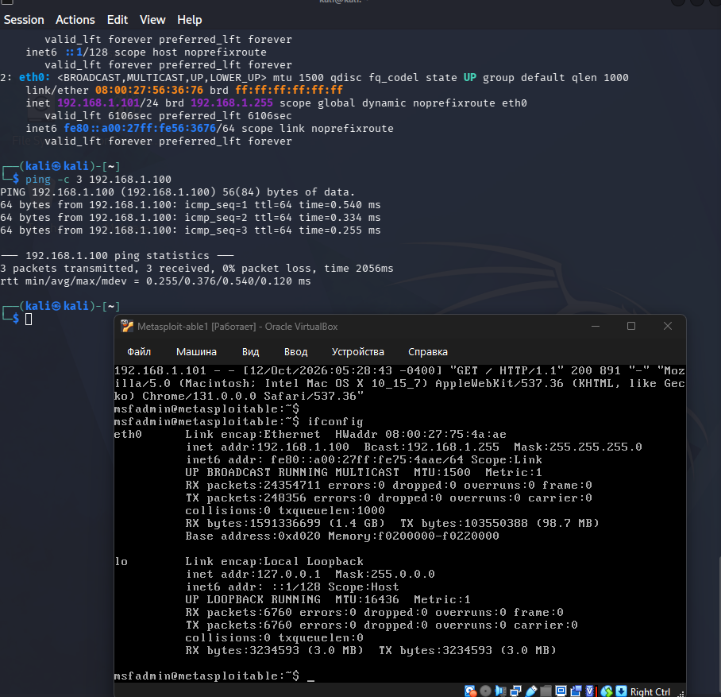
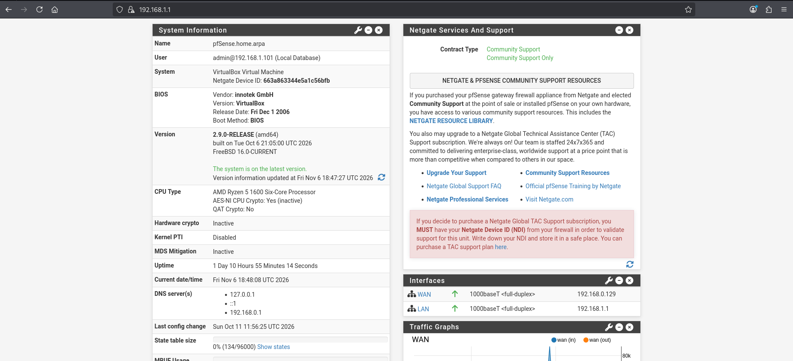
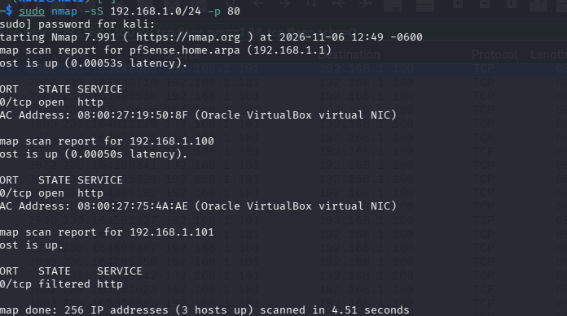
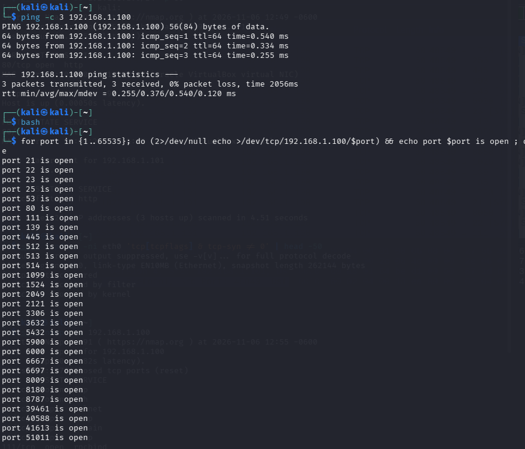
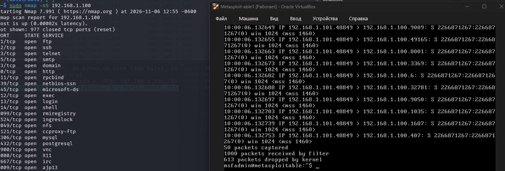
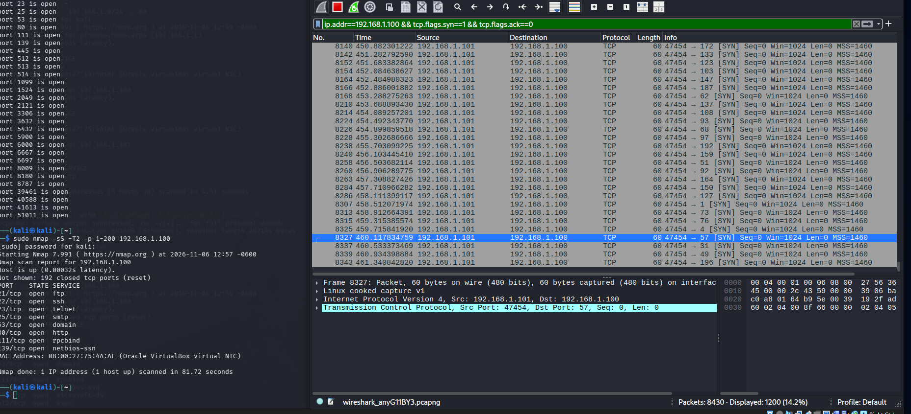
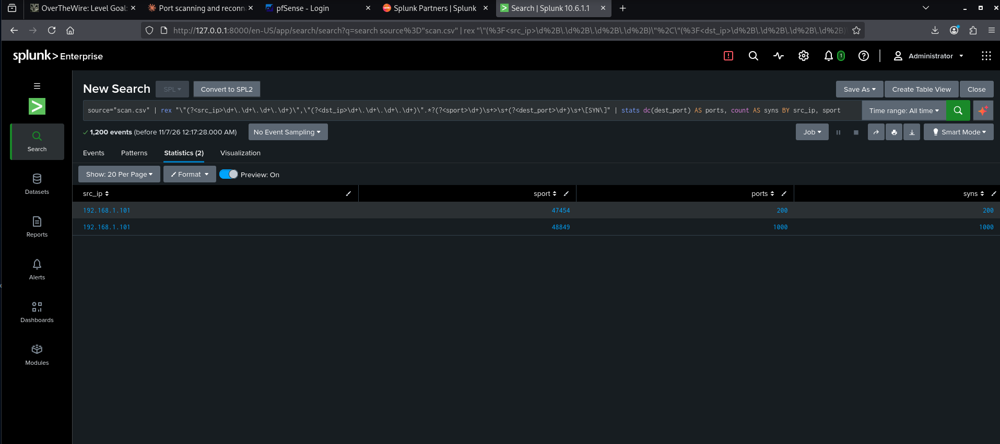
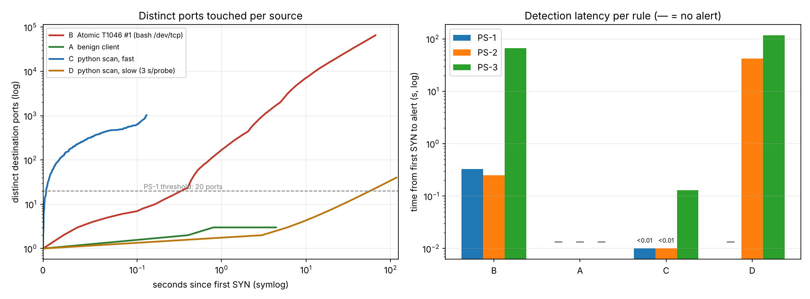

# Week 9 – Atomic Red Team applied to *Port Scanning and Reconnaissance*

**Course:** Introduction to Threat Hunting (ITH), 2026-2027, syllabus section 3.3, Week 9
**Syllabus task:** *Run selected atomic tests (e.g., T1059, T1003). Record and analyze the test results in a SIEM.*
**Our topic:** Port Scanning and Reconnaissance  |  **Team:** _<group name / members>_

## 1. Goal and approach
Instead of T1059/T1003 we work with the technique that belongs to our topic: **T1046 – Network Service Discovery** (port scanning once the
actor is inside or next to the target network). The same behaviour performed from outside is **T1595.001 – Active Scanning: Scan IP Blocks**.
We (1) run TCP SYN scans against a vulnerable host, (2) capture the traffic, (3) load it into a SIEM (Splunk) and (4) analyse it with detection logic.

## 2. Lab environment (VirtualBox)
| Item | Value |
|---|---|
| Attacker | Kali Linux, **192.168.1.101** (nmap 7.991, Wireshark/tshark, Splunk Enterprise 10.6.1.1) |
| Target | Metasploitable 2, **192.168.1.100** |
| Gateway | pfSense 2.9.0-RELEASE, LAN **192.168.1.1**, WAN 192.168.0.129 |
| SIEM | Splunk Enterprise 10.6.1.1 on Kali, data uploaded from the Wireshark CSV export (`scan.csv`) |




## 3. Atomic tests for T1046
Atomic Red Team's `atomics/T1046` lists 13 tests (checked on GitHub, raw `T1046.md`). Both Linux tests were executed in the lab, manually:

| # | Test | Command | Result in our lab |
|---|---|---|---|
| 1 | Port Scan (bash `/dev/tcp`) | `for port in {1..65535}; do (2>/dev/null echo >/dev/tcp/192.168.1.100/$port) && echo port $port is open ; done` | **30 open ports** found (full 1-65535 range) |
| 2 | Port Scan Nmap | `sudo nmap -sS 192.168.1.0/24 -p 80` | 256 addresses, **3 hosts up** in 4.51 s; port 80 open on pfSense (192.168.1.1) and Metasploitable (192.168.1.100), filtered on Kali itself |




Test #1 open ports (from the screenshot): 21, 22, 23, 25, 53, 80, 111, 139, 445, 512, 513, 514, 1099, 1524, 2049, 2121, 3306, 3632, 5432, 5900, 6000, 6667, 6697, 8009, 8180, 8787, 39461, 40588, 41613, 51011.

## 4. Procedure
1. Check connectivity (`ping -c 3 192.168.1.100`).
2. Run Atomic Test #2 (`sudo nmap -sS 192.168.1.0/24 -p 80`) and Atomic Test #1 (bash loop) from Kali.
3. Start a Wireshark capture on Kali and run two more nmap scans: `sudo nmap -sS 192.168.1.100` (scan 1) and `sudo nmap -sS -T2 -p 1-200 192.168.1.100` (scan 2).
4. In parallel on Metasploitable: `sudo tcpdump -ni eth0 -c 50 'tcp[tcpflags] == tcp-syn'` to see the scan from the victim side.
5. Export SYN packets (`ip.addr==192.168.1.100 && tcp.flags.syn==1 && tcp.flags.ack==0`) with Wireshark *File -> Export Packet Dissections -> As CSV*, upload `scan.csv` to Splunk (*Settings -> Add Data -> Upload*) and run the search in `evidence/real_lab/splunk_query.spl`.

## 5. Results (real lab)
**Scan 1** (`sudo nmap -sS 192.168.1.100`): "Not shown: 977 closed tcp ports (reset)", i.e. 23 open ports among the top 1000. **Scan 2** (`-T2 -p 1-200`): 192 closed ports shown, completed in **81.72 s**.



On the victim, tcpdump reports **1000 packets received by filter** (50 captured, 613 dropped by the kernel of the old Metasploitable): the whole scan reached the target in a fraction of a second, with source port 48849.



Wireshark: 8 430 packets in the capture, **1 200 displayed** by the SYN filter (14.2 %). Splunk search over `scan.csv`, time range *All time* – 1 200 events, two scans from one source:



| Scan | Source | Source port | SYN | Distinct dst ports | Duration | Rate |
|---|---|---:|---:|---:|---:|---:|
| 1 – default nmap SYN scan | 192.168.1.101 | 48849 | 1 000 | 1 000 | 0.073 s | ≈ 13 700 SYN/s |
| 2 – `-T2`, ports 1-200 | 192.168.1.101 | 47454 | 200 | 200 | 80.3 s | ≈ 2.5 SYN/s (one probe per 0.4 s) |

Duration and rate come from the first and last timestamp of each scan in the capture (230.1639-230.2368 s and 381.0216-461.3408 s).

## 6. Analysis
1. **Signature of a raw SYN scan.** Every packet is a bare SYN (length 60, `Win=1024`, `MSS=1460`) from one fixed source port per scan, to a different destination port each time, with no completed handshakes: this is what `nmap -sS` looks like on the wire.
2. **Two scans separated by source port.** Grouping by `src_ip, sport` splits one attacker into two runs, one wide and fast (1000 ports in 73 ms), one narrow and slow (200 ports in 80 s).
3. **Full-range scan finds more than the default scan.** Atomic Test #1 (all 65 535 ports) found **30** open ports; the default nmap scan of the top 1000 ports found 23. The extra ones include high ports (39461, 40588, 41613, 51011) that a top-1000 scan does not cover – services the owner may not know about.
4. **Test #2 is host discovery plus one port.** `-p 80` over the /24 maps which hosts are alive and which run a web server (pfSense and Metasploitable) – discovery of remote systems (T1018) as well as services (T1046).
5. **Detection rules applied to these timestamps** (same logic as `detect/siem/queries.md`):
   * PS-1 (>= 20 distinct ports in 10 s): scan 1 fires after the first 20 probes (< 1 ms); scan 2 fires at ≈ **+7.6 s**, because `-T2` still sends 25 ports in 10 s.
   * PS-2 (>= 15 distinct ports in 120 s): scan 2 fires at ≈ +5.6 s.
   * So `-T2` is **not** slow enough to evade a 10-second rule. A real evasion run needs a much longer delay, e.g. `nmap -sS --scan-delay 3s -p 1-40`, which our automated reproduction (§7) shows is caught only by the 120-second rule.
6. **pfSense cannot see this traffic.** Attacker and target are in the same LAN segment, so packets go through the virtual switch and not through the firewall. Detection therefore relies on the capture on the attacker (Wireshark) fed into Splunk. A production deployment needs the sensor on a mirror port or the traffic routed through the firewall.

## 7. Supplementary: automated loopback reproduction
To make the experiment repeatable, `lab/run_lab.sh` reproduces it on a single Linux host with loopback addresses: Atomic T1046 Test #1 (the bash loop above, 65 535 ports in 66 s), a fast and a slow Python scanner and a benign client, with a sensor writing JSON events and `detect/detect_scan.py` applying rules PS-1/2/3.



| Run | SYNs | Duration | Alerts |
|---|---:|---:|---|
| A benign client | 12 | 4.4 s | none |
| B Atomic T1046 #1 | 65 535 | 66.1 s | PS-1 (0.33 s), PS-2 (0.25 s), PS-3 |
| C python fast | 1 024 | 0.13 s | PS-1, PS-2, PS-3 |
| D python slow (3 s/probe) | 40 | 117 s | **PS-2 (42 s)**, PS-3; PS-1 missed |

This run is on loopback in an isolated container, not on the VirtualBox lab, and its detection is a Python script, not Splunk.

## 8. Limitations
* Single attacker and target in one LAN segment; no NAT, no background traffic, no legitimate scanners to allow-list.
* Splunk analysed an exported CSV, not live log forwarding. The Sigma rule and the Splunk/ES|QL queries in `detect/siem/` for PS-1/2/3 were written but only the grouping search in §5 was executed in Splunk.
* Thresholds (20 ports / 10 s, 15 ports / 120 s, 80 % resets) were chosen for this small sample, not tuned on production data.
* The Atomic repository tests were not run through the Invoke-AtomicRedTeam framework; commands were executed manually.
* The Wireshark capture loaded into Splunk (8 430 packets) holds the two nmap scans only. Atomic Tests #1 and #2 are documented by their terminal output (screenshots), not by Splunk events; a full-range Test #1 capture would contain 65 535+ SYN packets.

## 9. How to reproduce
```bash
# real lab: capture, export, load into Splunk (see section 4)
sudo tshark -i eth0 -f "host 192.168.1.100" -w /tmp/scan.pcapng
# automated loopback version
sudo ./lab/run_lab.sh && python3 detect/detect_scan.py week9/evidence
```

## 10. Sources
* Atomic Red Team, T1046 – <https://github.com/redcanaryco/atomic-red-team/blob/master/atomics/T1046/T1046.md>
* MITRE ATT&CK T1046 – <https://attack.mitre.org/techniques/T1046/>; T1595.001 – <https://attack.mitre.org/techniques/T1595/001/>
* Syllabus ITH 2026-2027, section 3.3, week 9.
